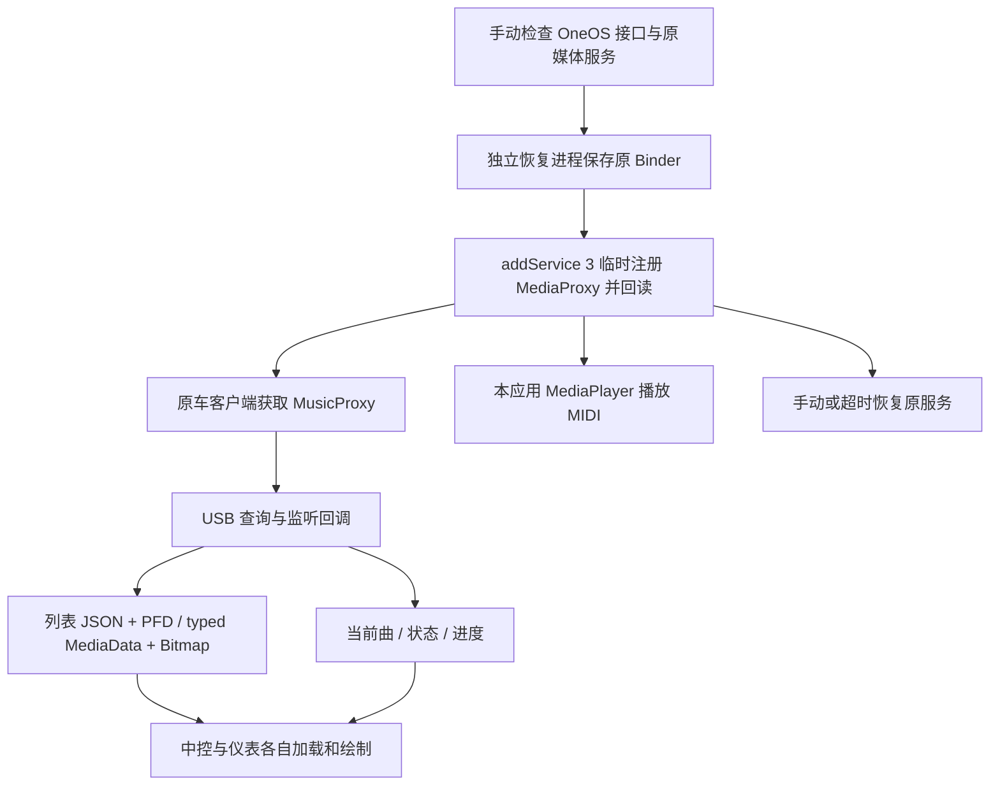

# Lynk OSN 仪表歌曲列表与专辑封面桥接

**Lynk OSN Playlist & Cover Bridge**

面向特定 OneOS / Android 9 车机的最小实验 App：通过临时 USB 媒体服务代理，向原车媒体客户端提供五首测试歌曲的播放列表、当前曲、封面、播放状态和进度，并用本应用的 `MediaPlayer` 播放内置 MIDI。

当前公开源码对应 **0.3.2（versionCode 4）**，包名 `dev.lynk.usbprobe`，minSdk / targetSdk 均为 28。源码许可证：**GPL-3.0-only**；音乐素材单独列于 [THIRD_PARTY_NOTICES.md](THIRD_PARTY_NOTICES.md)。

**这是验证原型，不是通用投屏软件，也不是完整的第三方音乐播放器桥接器。** 没有屏幕镜像：仪表读取结构化歌曲数据后，用原车 UI 自行绘制。没有 Root、系统 APK 替换、QQ 包名/签名伪装；但会临时改变共享媒体服务表项，能否调用相关接口取决于车机版本与权限。

## 当前版本：0.3.2

- 五首 MIDI 测试音乐、完整歌曲列表、当前曲和五张独立编号封面。
- JSON/PFD 与携带 Bitmap 的 typed 列表两种数据传递方式。
- 应用来源同步、歌曲 ID 统一，以及播放状态和进度回调。
- 手动恢复、主进程超时恢复、独立恢复守护与卸载自身入口。

运行依赖特定 OneOS 媒体服务和 Binder 契约，不是面向所有车型或固件的通用方案。离线构建不等于车机兼容性保证；使用前请阅读当前版本限制。

## 实现概览



## 项目文档

| 文档 | 内容 |
|---|---|
| [完整实现流程](docs/ARCHITECTURE.md) | 服务接入时序、代理路由、列表编码、封面推送、控制与恢复 |
| [封面获取与展示](docs/ALBUM_ART.md) | 原版 USB 封面来源、路径与 Bitmap 的区别，以及仪表加载逻辑 |
| [构建指南](docs/BUILD.md) | 开发环境、编译命令、输出与签名 |
| [当前版本说明](docs/RELEASE_NOTES_0.3.2.md) | 0.3.2 功能与安装包信息 |
| [已知限制](docs/KNOWN_LIMITATIONS.md) | 固件兼容性、文件权限、生命周期与恢复边界 |

## 下载与测试

安装包：`USB-Instrument-Probe-0.3.2.apk`。下载文件后可按[版本说明](docs/RELEASE_NOTES_0.3.2.md)中的 SHA-256 校验；源码需按构建指南编译后才能安装。

1. 停车，调低音量，拔掉 U 盘，暂停其他播放器，安装并打开 App。
2. 点“只读检查 OneOS 和原车 USB”，确认接口可读；错误时先导出日志。
3. 点“无U盘启动五首USB音乐（3分钟）”。观察 B1 服务表回读、S2 原服务真实音源与 P1 音频启动。
4. 观察仪表列表、当前封面、状态和进度；选第 3 首便于观察可能的前后项。分别测试应用按钮、仪表列表点选和上下曲，记录实际控制入口。
5. 完成后点“立即恢复原车媒体服务”，检查 R2。需要反馈时先“导出完整日志”。
6. 可点“卸载自身（先停止测试并恢复）”。应用尝试停止测试并恢复后打开系统卸载确认；用户仍需在系统界面确认。

测试约 180 秒自动恢复，独立进程约 185 秒尝试恢复。测试期间不要强停、直接卸载或使用清理器结束整个包；恢复守护也会被整包强停，不能保证断电或服务异常时恢复。恢复的是媒体服务 Binder 引用，不等于恢复之前歌曲、进度或音源。更多限制见 [KNOWN_LIMITATIONS.md](docs/KNOWN_LIMITATIONS.md)。

## 源码目录

```text
AndroidManifest.xml             包配置与双进程服务声明
src/dev/lynk/usbprobe/
  MainActivity.java             测试界面、日志导出、卸载入口
  ProbeService.java             代理注册、USB 数据与控制、音频播放、恢复
  RecoveryService.java          独立恢复进程、Binder 死亡与超时处理
  Track.java                    五首数据、96×96 封面、Parcel 与 JSON 编码
  Support.java                  Binder 调用、前台通知与日志
  Contracts.java                已核对的接口方法编号表
protocol/contracts.json         六组 115 项编号和 MediaData 字段顺序
assets/                         五首 MIDI 及来源、校验值
verification/                   0.3.2 APK 信息与源码构建一致性检查
build.py                        独立构建；无需原厂 APK 或第三方 Python 包
```

源码对应 0.3.2，包含六个应用 Java 文件、接口编号表及 Manifest。构建脚本不依赖原厂 APK。

0.3.2 的构建一致性记录见 [source-export-check.json](verification/source-export-check.json)：对应构建中的 DEX、二进制 Manifest 和五首 MIDI 与发布 APK 一致。不同工具链的输出、签名和整个 APK 文件不保证逐字节一致。

不包含原厂 APK / DEX / SDK 实现、反汇编全文、原始实车日志、账号资料或签名私钥。接口表是互操作所需的方法名称/编号快照，不是跨固件通用的官方 SDK。

## 反馈

请附上 Android / OneOS 版本、测试入口、单封面还是多封面、是否有进度、是否能恢复，以及删去个人内容后的诊断日志。D1 表示推送调用返回，不代表仪表已经显示；提供观察结果才能确认显示成功。

## 许可

Copyright (C) 2026 minyu.

本项目原创源码与文档依据 GNU General Public License version 3 only 发布，完整条款见 [LICENSE](LICENSE)。第三方 MIDI 素材按其来源声明处理，不因本项目而改换许可。
