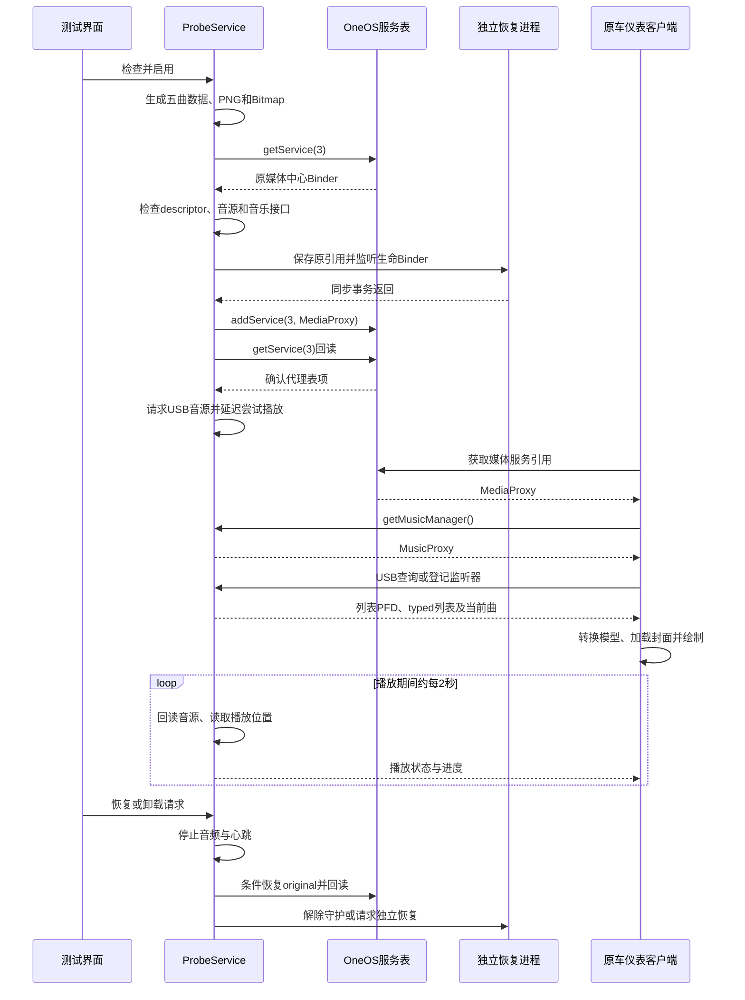

# 完整实现逻辑：0.3.2

## 1. 研究结论与选择 USB 路径的原因

原车客户端拥有 USB 专用的完整列表、当前曲及媒体监听协议。MultiMedia 是中控客户端，DimMenu 是仪表相关客户端；两者通过 OneOS 媒体中心获取数据。项目复用这条现有的数据消费链路，让原车界面显示应用提供的测试列表和封面。

验证原型选择复用 USB 数据协议，避免依赖 QQ 应用身份。它不将界面画面“投射”到仪表，也没有直接向显示硬件发送图片。仪表的数据获取和渲染代码保持原样。

## 2. 三条并行链路

| 链路 | 实现 |
|---|---|
| 元数据 | 本 App → OneOS 媒体代理 → 原车客户端 → 原车界面 |
| 音频 | 本 App 的 MediaPlayer → Android AudioManager / 音频焦点 → 系统音频输出 |
| 控制 | 仪表 USB Binder 控制或 App 按钮 → 本 App 选曲/暂停/继续/进度调整 |

原型没有把虚拟文件交给原 USB 播放引擎。音频文件位于本包私有 files 目录；原 USB 文件路径只是数据模型中的歌曲定位标识。原车是否实际切到 USB 通过原服务回读确认。

## 3. 检查并记录原服务

`ProbeService` 使用 HandlerThread 串行处理大部分工作，先启动前台通知。`Track.demo()` 将五首 MIDI 从 assets 复制到 files，生成五张不同颜色和编号的 96×96 Bitmap，并写入本包外部 files/covers 目录。

用户点检查或启用后，显式绑定：

```text
com.geely.service.oneosapi/
com.geely.service.oneosapi.OneOSApiService
```

验证 registry 描述符 `com.geely.lib.oneosapi.IServiceManager`，调用 `getService(3)` 保存原媒体中心 Binder，再获取原 `IMusicManager`。读取真实音源、应用来源、当前 USB 歌曲和队列。无 U 盘时原队列不可用可记录后继续；原媒体服务和接口描述符校验仍需成功。

检查并不注册代理。方法编号由 `Contracts.java` 提供，使用已核对的 Binder transact 协议，而非打包 OEM SDK 类。

## 4. 先建立恢复能力，再替换服务引用

`RecoveryService` 在 `:recovery` 进程运行。启用前，主进程将 registry、original、proxy 和主进程生命 Binder 交给恢复进程；后者通过 `linkToDeath()` 监听主进程死亡并设置 185 秒定时器。

确认原服务引用未变化后，主进程执行 `addService(3, proxy)`，再用 `getService(3)` 回读比较。B1 仅证明服务表指向代理，不证明某个客户端已经重新取得它或显示数据。已有缓存旧 Binder 的客户端未必立即进入新代理。

`MediaProxy` 拦截 `getMusicManager()` 返回嵌套 `MusicProxy`；其他根接口调用转交原媒体中心。`MusicProxy` 只在首个参数为 USB 音源 1 时处理指定方法，其他调用重置 Parcel 读位置后转交原音乐接口。Binder 透传的调用身份、异常行为与并发兼容性仍属于实验范围。

## 5. 队列与封面的两种编码

所有测试曲 `id = uri = MIDI 绝对路径`。每首 `art` 指向不同 `cover-N.png`，`bitmap` 保存该曲封面。

### JSON + ParcelFileDescriptor

`Track.json()` 输出 MusicBean 兼容字段：`id/path/name/title/artist/album/duration/albumArt`。JSON 写入临时文件，打开只读描述符后 unlink 文件；描述符仍持有可读内容。返回和回调通过 PFD 的 Parcelable 协议传递。

原后台使用 MemoryFile，验证版使用普通临时文件；两者并非完全相同实现。客户端按文件描述符读取字节并解析 JSON。`ResolveUtil` 的关键映射是 `path → id/uri`、`albumArt → albumCoverUri`。JSON 不传 Bitmap。

### typed MediaData

`writeTypedList(tracks)` 发送完整五项，每项同时含 Bitmap 与路径。`Track.writeToParcel()` 必须按原类型和顺序写：

```text
id, artist, name, duration, uri,
albumCover(Bitmap Parcelable), albumCoverUri, albumName,
source, isFavored, mediaType, isLrcSupported,
isReplaySupported, isFavorSupported, vip
```

其中 duration 是 long，source 以及最后六项以 int 编码。不能只按字段名字猜 Parcel 布局。公开协议快照列出这 15 个字段的顺序。

## 6. 主动查询与监听推送

| USB 方法 | 代理行为 |
|---|---|
| getCurrentMediaData | 返回当前 Track，带存在标志、Bitmap 和图片路径 |
| getPlayList | typed 完整五曲列表 |
| getUsbPlayList | JSON/PFD 完整五曲列表 |
| getPlayListAsync | 同步接收回调 Binder，后台通过 onUsbPlayListChanged 返回 PFD |
| addMediaStateListener / addMusicStateListener | 保存监听器，延迟约 250ms 推送 |
| getCurrentPlayState / getCurrentPosition | 返回本 App 的实际播放状态与缓存进度 |

`publish()` 按监听器类型使用不同 descriptor 和参数：多媒体监听带 `audioSource, appSource`，音乐监听带 `audioSource`。同步回调使用 reply，并检查异常。歌曲或时长变化时依次推送：

1. `onUsbPlayListChanged`：JSON/PFD 列表。
2. `onPlayListChanged`：五个带 Bitmap 的 typed MediaData。
3. `onMediaDataChanged`：当前曲。
4. `onPlayStateChanged`、`onPlayPositionChanged`：状态、进度和时长。

每约 2 秒心跳读取真实音源、刷新播放位置并推送状态/进度。不会在每个心跳无条件重发全部列表。D1/D2 只表示调用返回，没有客户端加载图片的反馈协议。

## 7. 音源、播放和控制

启用时初始回调 appSource 为已知值 1，调用原服务 `requestAudioSource(USB=1, UNKNOWN=0)`，随后在真实音源为 USB 时读取并同步 `getCurrentAppSource()`。请求切源的应用来源参数和向客户端回调的应用来源是两个不同位置的参数。S1 表示调用完成，S2 才是原服务音源回读。

约 1200ms 后尝试 `MediaPlayer` 播放。AudioManager 请求媒体音频焦点；焦点 LOSS 暂停，不强行绕过系统仲裁。MIDI 解码/合成依赖车机 Android 实现，播放失败不等于数据代理一定失败。

`next/prev/playItem/play/pause/seekTo/replay` 映射本应用控制；播放结束循环切到下一首。`playItem` 按 id 或 uri 匹配。某些 `PLAY_*` 字符串命令只记录，不会交给原 USB 服务播放私有测试路径，因此中控部分点选入口可能无效。

## 8. 恢复和卸载

触发恢复的入口包括手动按钮、约 180 秒超时、观察到 USB 音源离开、服务表被其他来源更新、任务移除及部分生命周期清理。独立进程另处理超时/主进程死亡。

恢复先停止音频和心跳。当前表项仍是本代理时，重新写入 original 并回读；已变成其他服务时不强行覆盖。主进程尽力将记录的监听器登记回原服务，清空本地监听表，解除恢复守护并结束前台服务。

0.3.2 卸载入口通过 ResultReceiver 等待恢复分支成功后，让前台 Activity 发出 `ACTION_DELETE package:dev.lynk.usbprobe`。系统仍要求用户确认，应用不会静默卸载。恢复报错不打开卸载界面。监听器重注册失败只记日志，不会阻断成功返回；绑定恢复服务失败等路径也缺少完整超时反馈，所以“成功”不是对所有系统状态的绝对保证。

## 9. 移植到真实播放器

需获取目标播放器真实完整队列、稳定歌曲 ID、当前曲、封面与播放状态，并把控制回送目标播放器。Android 通知或 MediaSession 不保证提供完整队列；只有当前曲时不能虚构出完整歌曲列表。还需要长期服务、并发监听、生命周期恢复、Binder 权限和不同固件契约的专项验证。0.3.2 不实现这些产品化能力。

## 10. 从启动到显示的完整时序



图中获取代理、登记监听和绘制是客户端需要完成的步骤，不能保证每个固件都按相同时机触发。主进程死亡时，恢复进程通过保存的 Binder 自行尝试恢复，不依赖图中最后的 UI 请求。

## 11. 一次切歌如何更新列表与封面

以选择第 3 首为例：

1. 应用按钮直接发送 `select(index=2)`；仪表点选则经过 `playItem`，按歌曲 id/uri 找到相同索引。
2. `select()` 确认代理处于 active 状态，更新 index，并调用 `startAudio()` 释放上一播放器、申请焦点、准备并启动该曲。
3. `publish()` 对每个监听器比较 `lastIndex` 与当前 index。变化时重新发送列表和当前曲，避免只改音频却不更新元数据。
4. JSON/PFD 列表中的第三项具有同一音频 path 和独立 cover-3.png；typed 列表第三项同时具有该路径及编号 3 的 Bitmap。
5. 当前曲使用同一个 Track 编码，id、uri、封面路径与列表项保持一致，便于客户端关联列表选中项。
6. 仪表将数据转为自身界面模型。支持 Bitmap 的入口可直接显示；只走 JSON 的入口必须成功读取封面文件。
7. 推送状态与位置，后续心跳更新进度。若音频启动失败，日志记录失败，不能仅凭元数据变化认定音频已正常播放。

完整列表是五个 Track 的集合，当前曲是其中一项；不是把一张图片复制成五个列表项。仪表最终采用列表页、单封面页或卡片页，由原车 UI 决定，项目不控制其页面布局。

## 12. 关键字段如何保持一致

| Track 字段 | JSON/PFD 字段 | typed MediaData 字段 | 用途 |
|---|---|---|---|
| id / uri | id / path | id / uri | 当前曲匹配列表、点选定位 |
| name | name / title | name | 歌曲标题 |
| artist | artist | artist | 歌手信息 |
| album | album | albumName | 专辑名称 |
| duration | duration | duration | 时长，毫秒 |
| art | albumArt | albumCoverUri | 接收进程读取的PNG路径 |
| bitmap | 无 | albumCover | 通过Parcel传递封面像素 |
| source=1 | 由USB调用上下文确定 | source=1 | USB来源路由 |

JSON 解析方可能由 path 重新生成 id，因此 id 与 path 必须对应。appSource 是回调参数，不在上述 JSON 歌曲字段中；音频来源、应用来源和歌曲 ID 不能互相替代。

## 13. 用日志定位数据链路

| 阶段 | 日志 | 可以判断什么 |
|---|---|---|
| 生成数据 | A0 | 五首测试数据准备完成 |
| 服务连接 | A1、A2 | 绑定请求与registry描述符检查 |
| 原服务检查 | A3、A4、A5 | 原媒体中心、当前曲与列表读取情况 |
| 恢复守护 | R0、R1 | 独立恢复服务的绑定与连接 |
| 代理注册 | B1 | 服务表回读确认本代理 |
| 客户端接入 | B2 | 客户端取得音乐代理接口 |
| 主动查询 | C1、C2、C3、C4 | 当前曲、typed列表、PFD及异步入口命中 |
| 监听推送 | C5、D1、D2 | 登记监听、发送列表/当前曲、发送状态/进度 |
| 切源 | S1、S2、S3 | 切源调用、真实音源回读与appSource同步 |
| 音频 | P0、P1、P2、P3 | 焦点、播放启动、焦点变化及解码错误 |
| 恢复 | R2 | 主进程恢复检查；独立进程另有RECOVERY日志 |

若 B1 成功但无 B2，先检查客户端是否仍缓存旧接口；若有查询或推送却无封面，检查接收入口、appSource、歌曲匹配和图片可读性。D1 不能证明图片解码成功，R2 也不代表恢复之前音源。排查时分别确认数据、显示和音频三条链路。
